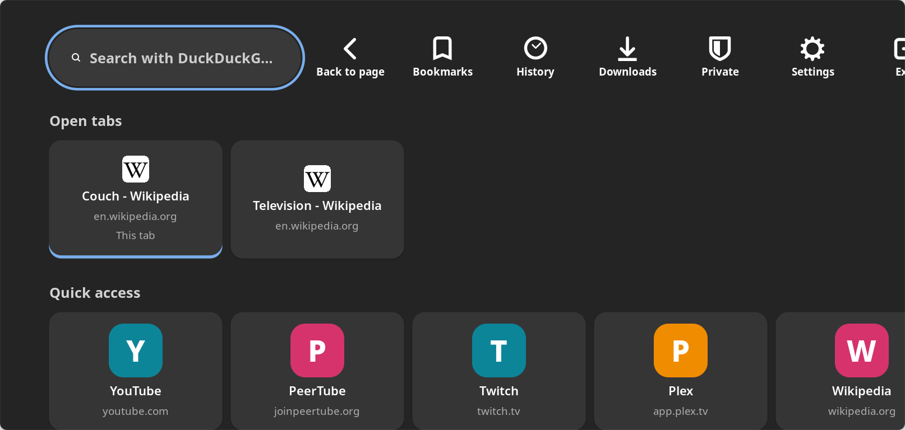
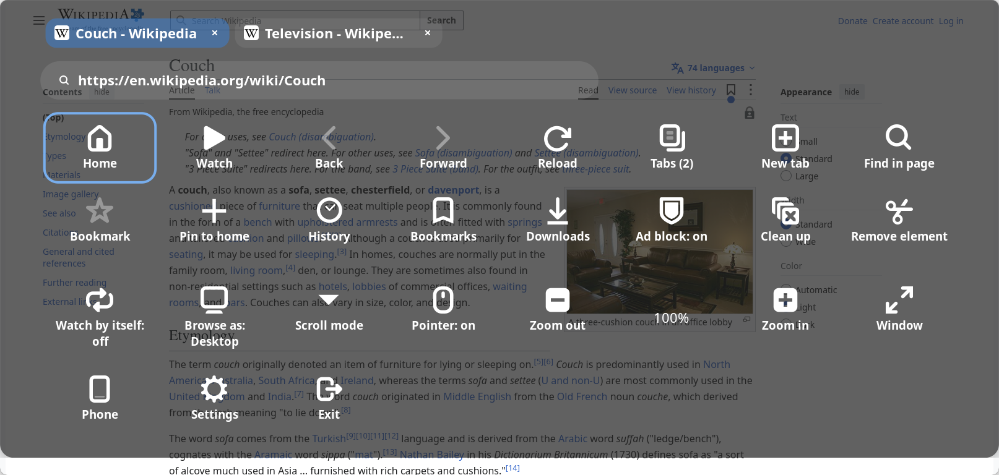

# Sofa TV Browser for Linux

**A web browser for the TV, made to be used from the couch.** Plug a PC or mini-PC into the TV, sit back, and
browse with a TV remote, a game pad, your phone, or a wireless mouse and keyboard. Big buttons, a big pointer, ads
blocked, and one button that throws the page's video into mpv, full screen.





## Why

Desktop browsers are built for a desk: small text, small buttons, and a mouse that needs a table. On a TV across
the room they're hard to read and awkward to drive. Sofa is built for that room instead:

- **Everything is big and reachable with arrows.** Home, the menu, Settings and the search box all work with
  arrows and OK, so a cheap TV remote is all you need.
- **The page has a pointer you drive from the remote.** You don't jump from link to link. Hold an arrow to speed
  up, push against an edge to scroll, and hold OK for a link's menu.
- **Video goes to a real player.** Press Play and the page's main video opens full screen in mpv. It uses hardware
  decoding, picks the best quality for your screen and remembers where you stopped.
- **It stays out of your way.** Ads, trackers, pop-ups, cookie walls and "Leave this page?" traps are handled for
  you.

## Highlights

| | |
|---|---|
| 🎮 **Any controller** | TV remotes (they show up as keyboards), Xbox, PlayStation and 8BitDo game pads, a mouse and keyboard, or your phone |
| 📱 **Phone remote** | Scan a QR code and your phone becomes a trackpad, a keyboard and a remote. No app to install |
| 🗂️ **Tabs** | Up to six, shown across the top of the menu, each with ×. Ctrl+T for a new one; right-click a link to open it in the background |
| 🛡️ **Ad blocking** | Built into the web engine. Two lists come built in, and EasyList, uBlock Origin, AdGuard and more are one switch away. **Clean up** and **Remove element** handle the rest |
| ▶️ **Watch** | One button: the page's main video, full screen in mpv (with yt-dlp for YouTube and similar) |
| 🖱️ **Big pointers** | The mouse pointer and the remote's dot are larger than usual, in four sizes |
| 🔒 **Private** | No accounts, analytics or phoning home. Private browsing, history limits, and clear-on-exit |
| 🌗 **Made for a TV** | Dark or light, an interface size for viewing across the room, a see-through menu that wraps onto rows |

It's a Linux port of [Sofa TV Browser](https://github.com/sonalder-darlene/sofa-tv-browser), the Android TV app,
for Pop!_OS, Ubuntu and other Linux desktops. The Android app is Kotlin built on Android's WebView and Media3, none
of which runs on Linux, so the port is new code in Python with GTK 4, libadwaita and WebKitGTK. It keeps Sofa's
design, its privacy defaults and its bundled filter lists. mpv plays the videos in place of "Sofa Player". Tabs, the
finer ad blocking and the phone remote come from
[TVCouchBrowser for Linux](https://github.com/crash101g/tvcouchbrowser-desktop).

## Install (Pop!_OS 24.04 / Ubuntu 24.04)

```sh
git clone https://github.com/crash101g/sofa-tv-browser-linux.git
cd sofa-tv-browser-linux
./install.sh
```

This installs the system packages it needs with apt (`python3-gi python3-cryptography gir1.2-gtk-4.0 gir1.2-adw-1
gir1.2-webkit-6.0 gir1.2-manette-0.2 mpv`), then puts Sofa in `~/.local/share/sofa-tv-browser`, a `sofa-tv-browser` command in
`~/.local/bin`, and "Sofa TV Browser" in the app grid. `./uninstall.sh` removes it again (`--purge` also removes
your settings, bookmarks and history).

For YouTube and similar sites, mpv needs a **current** yt-dlp (Ubuntu's package is usually too old):

```sh
sudo apt install pipx && pipx install yt-dlp     # and now and then: pipx upgrade yt-dlp
```

To run without installing, from this folder: `./sofa-tv-browser`.

## Using it

| Remote / keyboard | Game pad | What it does |
|---|---|---|
| Arrows | Left stick or D-pad | Move the pointer. Hold to speed up. Push against an edge to scroll |
| Enter / OK | A | Click. Hold still for a second: the menu of a link or image, or else scroll mode. Hold and move: drag |
| Escape / Back | B | The menu (or the previous page, if Settings → Browsing says so). In a text field, Escape gives the keys back to the pointer |
| Menu / F1 | Start | The menu |
| Play / F2 | X | **Watch**: the page's main video, fullscreen in mpv |
| Search key / F6 / Ctrl+L | Y | Search or type an address |
| Home key on the remote / Alt+Home | Select | Home |
| Page Up / Down | L2 / R2 | Scroll a page |
| Alt+← / Alt+→ | L1 / R1 | Back and forward |
| | Right stick | Scroll what is under the pointer |
| Ctrl+F, Ctrl+D, Ctrl+± / Ctrl+0, F5, F11 | | Find in page, bookmark, zoom, reload, full screen |
| Ctrl+T, Ctrl+W, Ctrl+Tab / Ctrl+Shift+Tab | | New tab, close tab, next / previous tab |
| Right-click on a link (mouse) | | Open it in a new tab in the background |

A real mouse and keyboard work as usual too. Moving the mouse hides the remote's pointer, and moving it to the very
top of the window opens the menu (it closes again when the mouse goes back down over the page, unless you clicked
in it). Text fields take the
keyboard while they have focus, and a `<select>` list opens as a large chooser.

In mpv: Enter or Space pauses, ←/→ seek 10 s, ↑/↓ change the volume, `c` cycles subtitles, `a` cycles audio,
`i` shows video info, and Escape/Back goes back to the page, remembering where you stopped. Game pads and the
phone remote work in mpv as well.

## Your phone as a remote

Menu → **Phone** shows a QR code. Scan it with the phone's camera: the page that opens, served by this computer,
is a trackpad, a keyboard and a remote. Nothing to install on the phone.

| On the phone | What it does |
|---|---|
| Open on TV | Opens a website or a search in the current tab |
| Drag one finger on the trackpad | Moves the pointer (the **Speed** slider sets how far) |
| Tap | Click |
| Hold still, then drag | Press and drag: sliders, slide-to-unlock, maps |
| Hold still, then let go | The menu of the link or image under the pointer |
| Two fingers: drag / pinch / tap | Scroll / zoom / the link's menu |
| ✂ Remove / 🧹 Clean up | Remove the element under the pointer / clean up the page |
| Type into the TV | Types into the text field the pointer is on (or the one with focus), or Sofa's own search |
| Remote pad | Arrows, OK, Back, Menu, Home, play/pause, and **Watch** |

On Sofa's own screens (Home, the menu, Settings), the trackpad moves between buttons and a tap presses one. While
mpv plays, the phone's keys control mpv.

The phone remote is **off until you pair a phone**, and it runs only while Sofa's window is on screen. It answers
only devices on this computer's own home network, never other programs on this computer, and every request needs
the 128-bit token in the QR code; five wrong tokens block an address for ten minutes. Settings → Phone remote turns
it off and can forget paired phones (a new QR code).

The page is **HTTPS**, so someone watching your home network's traffic can't read the token or what you type. Sofa
makes its own certificate (kept in `~/.config/sofa-tv-browser`), and no authority vouches for it, so the first time
the phone warns that the connection isn't private: that's expected, continue to the page. After that it warns
again only when Sofa makes a new certificate, every two years; a warning at any other time means something else
answered in Sofa's place. For a phone or an iPhone Shortcut that won't accept the certificate, Settings → Phone
remote → **Plain HTTP** turns the old unencrypted page back on; turning it off again also makes a new QR code.
With a firewall on, allow the port: `sudo ufw allow 8765/tcp`. If Avahi is installed
(`avahi-utils`), Sofa also announces the page on the network.

## What it does

- **A pointer on the arrow keys**, with hover, drag, and scrolling by pushing against an edge. It works across
  frames, including other sites' frames. Hold OK on a link or image to open it, play it in mpv, download it or
  copy its address.
- **Game pads** (Xbox, PlayStation, 8BitDo and others) through libmanette, laid out as a console browser lays
  them out.
- **A menu on the Back key**, across the top of the page: address, Watch, back and forward, reload, tabs, find in page, bookmark, pin to
  Home, history, bookmarks, downloads, ad blocking, Clean up, Remove element, "Allow once", Watch by itself,
  "Browse as" desktop, mobile, TV or WebKit, scroll mode, pointer on or off per site, zoom, full screen, the phone
  remote, settings, and Exit (closes Sofa, like Ctrl+Q). The buttons wrap onto as many rows as the screen needs, so nothing is hidden off to the side.
- **Tabs**: up to six. With two or more, the menu shows them across its top: click or press OK on one to go to
  it, or on its × to close it. They are also in Tabs in the menu and in "Open tabs" on Home. Ctrl+T opens a new
  tab at the end, ready to type an address. Right-click a link to open it in a new tab in the background (muted
  until you look at it), or hold OK on it for "Open in new tab". A tab out of sight pauses its videos. Tabs reopen
  at the next start (Settings → Browsing), except private ones.
- **A big mouse pointer**, twice the usual size, so you can see it from the couch. Settings → Appearance →
  Pointer size: the desktop's, Large, Extra large or Huge. The remote's on-screen dot grows with it.
- **A Home screen** with your open tabs, your own tiles, your most visited sites and your bookmarks.
  Right-click a tile, or press Menu or Delete on it, to remove it (or close the tab).
- **Watch**: one press of Play finds the page's largest video and plays it fullscreen in mpv.
  - A plain video file or stream is opened directly, with the page's cookies, referrer and user agent.
  - A stream the page builds itself (YouTube's, for one) goes to mpv as the page's address, and yt-dlp finds it.
    The page's cookies go with it, so signed-in sites keep working.
  - mpv uses hardware decoding, picks the best quality up to your screen's height (or the limit in Settings),
    and continues long videos where you stopped.
  - When mpv can't play the video, a note says why and the site's own player carries on, filling the window.
  Settings → Video can turn mpv off; Watch then fills the window with the site's player.
- **Open videos in mpv**: a video you start on a page yourself goes to mpv at the same position, if it has sound
  and lasts a minute or more. Muted previews, loops and short clips stay on the page.
- **Watch by itself** (off by default): Watch runs on its own once a page has loaded, either on every site or only
  on the sites you choose in the menu.
- **Ad blocking with filter lists** in hosts, Adblock Plus and uBlock Origin formats, compiled into WebKit's
  content blocker. Requests are blocked inside the web engine, and element hiding covers elements a page adds
  later.
  - The StevenBlack hosts list and HaGeZi's Pop-Up Ads list come with Sofa (about 126,000 domains).
  - Settings → Filter lists turns on more, one by one: EasyList, EasyPrivacy, the uBlock Origin lists (ads,
    privacy, badware, quick fixes, unbreak, cookie notices, annoyances), AdGuard's lists, Peter Lowe's list and
    Fanboy's Annoyance. Each is downloaded from its publisher when turned on. Any other list can be added by its
    address. The exceptions of every list in use apply to all of them, as in uBlock Origin.
  - Compiling takes a few seconds per list the first time (all sixteen: about a minute); later starts load them
    at once.
  - Captchas (reCAPTCHA, hCaptcha, Cloudflare Turnstile, Arkose) are never blocked, whatever a list says.
  - **Ad block** in the menu: on or off for this site or everywhere, the filter lists, and an update.
  - **Clean up** removes full-screen overlays, cookie and newsletter walls and sticky ad bars, and makes a
    scroll-locked or blurred page usable again. It can run by itself on chosen sites.
  - **Remove element**: point at something the lists miss and press OK; Sofa remembers it for that site. Ad block
    in the menu brings removed elements back.
  - **YouTube**: a small script takes the ad entries out of YouTube's player data (Settings → Ad blocking; YouTube
    may change or notice this).
- **Pop-ups**: windows a page opens without a press, and windows to listed ad sites, are blocked; "Allow once" in
  the menu opens the last one in a new tab. After a press, a window to the same site opens in a new tab, and a
  window to another site asks first: the click-anywhere pop-under trick is as common as a real link.
- **Page dialogs**: a page's alert, confirm and prompt boxes appear as Sofa's own dialogs, so the remote and the
  phone can answer them. A page gets two per visit; more are dismissed. "Leave this page?" never traps Back.
- **Search** with the engine you choose at first start, with optional suggestions.
- **Downloads** to your Downloads folder, with progress, cancel and open.
- **Private browsing** (Home → Private) in a separate session whose cookies and data are gone when it ends.
- **Dark and Light themes** that websites follow too, and an interface size made for a TV across the room.

## Privacy

- **Nothing of its own:** no accounts, analytics, ads or crash reports. Apart from the sites you visit, Sofa only
  contacts:
  - your search engine, for suggestions, if you turn them on;
  - the publishers of the filter lists you turn on or add, and only when you do or when they update;
  - whatever yt-dlp contacts to find a video's stream when you Watch.
- **No servers unless you pair a phone:** the phone remote's small web server on your home network starts only
  after Pair phone (see [Your phone as a remote](#your-phone-as-a-remote)).
- **Blocking:** ads and trackers are blocked on this computer. Third-party cookies are blocked too, and WebKit's
  Intelligent Tracking Prevention is on.
- **Blending in:** Sofa uses a desktop Chrome user agent by default and sends no Do Not Track. Global Privacy
  Control can be turned on in Settings.
- **Pages get nothing extra:** no camera, microphone, location or notifications.
- **History** is kept for as long as you choose: 7, 30 or 90 days (the default), always or never. Settings can
  clear all browsing data, now or every time Sofa closes.

## Differences from the Android app

- **Sofa Player is mpv.** mpv's own decoders, quality choice, subtitles and frame rate handling replace Media3.
  For frame-rate matching, mpv's `--video-sync=display-resample` can go in Settings → Video → Extra mpv options.
- **Protected (DRM) video**, such as Netflix or Disney+, does not play: WebKitGTK has no Widevine. Use Chrome or
  Firefox for those services.
- **No voice search** (Linux has no system speech service) and **no built-in updater**: update by downloading a
  newer copy and running `./install.sh` again.
- **Redirects to listed ad sites** are stopped by WebKit's content blocker, which blocks every page load to those
  domains, including addresses you type.
- Sofa's mpv key bindings live in `~/.config/sofa-tv-browser/mpv/input.conf`. While Sofa runs mpv, that file is
  used instead of your own mpv `input.conf`; mpv's default bindings still work.
- **Tabs, the phone remote, Clean up and Remove element** are not in the Android app; they come from TVCouchBrowser.
- **The ad blocker is WebKit's content blocker, not uBlock Origin.** Rules WebKit can't express are left out:
  regular-expression rules, redirects, `$removeparam`, `$csp`, scriptlets (`##+js`), procedural selectors such as
  `:has-text()`, and element-hiding exceptions (`#@#`).

## For developers

```sh
./sofa-tv-browser                          # run from the source folder
python3 -m unittest discover tests         # the logic tests
```

Layout:

```
sofa/app.py        the window, tabs, the remote's keys, Watch, the menu actions, the phone's actions
sofa/browser.py    the tabs' WebKit views: settings, ad blocking per tab, pop-ups, dialogs, downloads
sofa/page.js       the script in every frame (its own script world): pointer events, Watch, text fields,
                   clean up, remove element
sofa/pointer.py    the D-pad pointer (and the phone's trackpad)
sofa/cursors.py    the big mouse pointer, from the cursor theme's large pictures
sofa/adblock.py    filter lists → WebKit content-blocker rules; removed elements; the YouTube script
sofa/phone.py      the phone remote's web server, WebSocket and pairing token
sofa/phone.html    the page the phone opens
sofa/qr.py         the pairing QR code (vendor/qrcode.js, run in JavaScriptCore in a helper process)
sofa/player.py     mpv and yt-dlp
sofa/gamepad.py    game pads through libmanette
sofa/ui.py         Home, the menu, search, find in page, list pages
sofa/settings.py   Settings and first-start setup
sofa/data/         the bundled filter lists
```

Settings, the phone pairing token, the database, filter lists and mpv's resume points are kept in
`~/.config/sofa-tv-browser`, `~/.local/share/sofa-tv-browser` and `~/.cache/sofa-tv-browser`.

## Ideas for later

See [WISHLIST.md](WISHLIST.md). Suggestions and pull requests are welcome.

## Licence

GNU General Public License v3.0 only (`GPL-3.0-only`), as Sofa TV Browser. Third-party parts, including the
MIT-licensed code from TVCouchBrowser, are listed in [NOTICE.md](NOTICE.md). Thanks to the authors of the original
Sofa TV Browser and of TVCouchBrowser, and to the StevenBlack, HaGeZi, EasyList, uBlock Origin, AdGuard and Peter
Lowe list maintainers.
